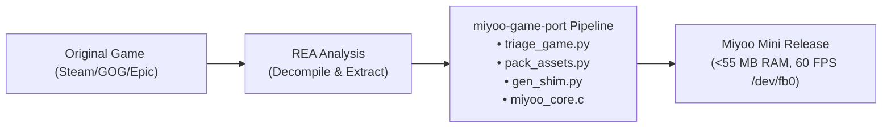

# Miyoo Mini Game Port Architect (`miyoo-game-port`)

[](LICENSE)
[](https://onionui.github.io/)
[](#hardware-profile)
[](SKILL.md)

An agentic skill and tool suite for **reverse engineering, shimming, and recompiling PC/console 2D games for the Miyoo Mini and Miyoo Mini Plus (OnionOS)**.

Designed to work as the embedded deployment companion to **[REA (Reverse Engineer Anything)](https://github.com/morluto/rea)**.

---

## 🎯 What This Solves

The Miyoo Mini / Plus is powered by a **SigmaStar SSD202D** SoC (Dual Cortex-A7 @ 1.2 GHz) with only **128 MB of RAM** and **NO 3D GPU** (no OpenGL ES, no Vulkan).

Standard commercial engines (Unity, Godot, Unreal, Heavy MonoGame) cannot run directly on this hardware because:
1. They require 200MB–1GB+ of RAM.
2. They demand GPU shader pipelines.
3. They rely on heavy desktop windowing libraries.

`miyoo-game-port` provides the **Clean-Room Recompilation & Hardware Blit (CRRHB)** architecture:
- **Clean-Room Engine Shims**: Replace heavy desktop engine runtimes with lightweight, hand-tuned API stubs.
- **NEON Software Blitter**: Blits directly into `/dev/fb0` with SIMD $2\times$ scanline scaling and handles the 180° inverted panel orientation.
- **128MB Memory Enforcer**: Packs raw assets into linear, $O(1)$-seekable indexed 8-bit palette textures (`game.pack`), cutting RAM usage by 75%.
- **Zero Copyrighted Bloat (BYOD)**: Keeps ports strictly Bring-Your-Own-Data compliant for clean legal distribution.



---

## 🚀 Engine Compatibility Matrix

| Engine | Examples | Strategy | Feasibility | Typical RAM |
| :--- | :--- | :--- | :--- | :--- |
| **Unity (2D / 4.x - 2017)** | *Kingdom: New Lands* | Clean-room `UnityEngine` shim + `miyoo_core.c` + Mono ARMHF | **95%** | ~45-55 MB |
| **MonoGame / XNA / FNA** | *Celeste*, *Fez*, *Stardew Valley* (1.3) | Clean-room `FNA` / `Microsoft.Xna.Framework` shim + `miyoo_core.c` | **95%** | ~25-45 MB |
| **GameMaker Studio** | *Undertale*, *Downwell*, *Hotline Miami* | Lightweight runner or GML decompilation to C++ blitter | **85%** | ~20-40 MB |
| **Godot Engine 2D** | *Brotato*, *Dome Keeper* | Headless ARMHF Godot build with custom `/dev/fb0` rasterizer | **75%** | ~45-65 MB |
| **Custom C / C++ 2D** | Retro ports & SDL games | Cross-compile with `arm-linux-gnueabihf-gcc` + `miyoo_core.c` | **90%** | ~15-35 MB |

---

## 📦 Repository Structure

```
miyoo-game-port/
├── SKILL.md                          # Main Agent Skill definition
├── README.md                         # Documentation & Quickstart
├── LICENSE                           # MIT License
├── package.json                      # Package metadata
├── scripts/
│   ├── triage_game.py                # Automated game analysis & feasibility diagnostic
│   ├── pack_assets.py                # Linear asset pack builder (8-bit palette / 16-bit)
│   ├── gen_shim.py                   # ECMA-335 C# API shim generator
│   └── api_surface.py                # Binary assembly inspector
├── templates/
│   ├── native_core/
│   │   ├── miyoo_core.h              # Hardware blitter C interface
│   │   └── miyoo_core.c              # Cortex-A7 NEON /dev/fb0 blitter & evdev driver
│   ├── onionos/
│   │   └── launch.sh                 # Standardized OnionOS launch script
│   └── build/
│       └── compile.sh                # Clean-room BYOD build pipeline
└── references/
    ├── engine_matrix.md              # In-depth porting guide across all game engines
    ├── hardware_specs.md             # SigmaStar SSD202D low-level reference
    └── rea_integration.md            # REA (Reverse Engineer Anything) pairing guide
```

---

## 🛠️ CLI Quickstart

### 1. Triage a Target Game
Check if a game can run on the Miyoo Mini Plus:
```bash
python3 scripts/triage_game.py /path/to/game_directory
```
Outputs total asset footprint, engine identification, memory risk score, and recommended quantization strategy.

### 2. Pack Assets into Linear Binary
Quantize textures to 8-bit indexed palette (reducing RAM by ~75%) and build single-file seekable package:
```bash
python3 scripts/pack_assets.py --input /path/to/extracted_assets --output game.pack --format indexed8
```

### 3. Generate Clean-Room Shims (for C# / Unity / MonoGame)
```bash
python3 scripts/gen_shim.py /path/to/Managed output_stubs.cs --hand ./engine/HandWritten
```

### 4. Build Native Core
Compile for device with ARM toolchain:
```bash
arm-linux-gnueabihf-gcc -O3 -shared -fPIC templates/native_core/miyoo_core.c -o libmiyoo_core.so -lpthread
```
Or compile for desktop preview (requires SDL2):
```bash
gcc -O3 -shared -fPIC -DMIYOO_DESKTOP templates/native_core/miyoo_core.c -o libmiyoo_core.so $(sdl2-config --cflags --libs) -lpthread
```

---

## 🤖 Using as an Agent Skill

Add this skill to your Antigravity, Claude Code, or Codex agent workspace:

```bash
# Antigravity (global)
git clone https://github.com/devarshi16/miyoo-game-port ~/.gemini/config/skills/miyoo-game-port

# Or copy into any project's .agents directory
cp -r miyoo-game-port my_project/.agents/skills/miyoo-game-port
```

When prompt-engineering your agent, instruct it:
> *"Use `miyoo-game-port` alongside `reverse-engineer-anything` to triage `<GameName>`, extract its asset delta, generate clean-room API shims, and target `/dev/fb0` on the Miyoo Mini Plus."*

---

## 📄 License

MIT License. See [LICENSE](LICENSE) for details.
