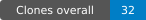

# Miyoo game port development skill

[](references/repository_metrics.md)
[](references/repository_metrics.md)

GitHub-reported clones; week starts Monday (UTC). [Snapshot and update setup](references/repository_metrics.md).

Version 1.2.4. This repository supplies an agent workflow and development scaffolding. It is **not** an automatic game converter, a universal Unity runtime, or a guarantee that a named engine/game is portable.

Read [SKILL.md](SKILL.md) for the workflow and [hardware guidance](references/hardware_specs.md) before device work. [Engine strategies](references/engine_matrix.md) distinguish research options from implementations. REA is optional.

Included helpers:

- `scripts/triage_game.py`: file/engine indicators; feasibility and packed working-set memory remain unknown until inspected.
- `scripts/pack_assets.py`: MPAK v1 writer for already extracted images and generic files. Exact indexed RGBA palettes up to 256 colors; RGBA32 fallback above that. The game runtime must implement a reader. WAV files retain their container headers.
- `scripts/api_surface.py`, `gen_shim.py`, `stage1dump.cs`: Unity-oriented metadata/declaration helpers. Throwing generated placeholders require the supplied `templates/managed/StubLog.cs` or an equivalent implementation. They do not implement engine behavior.
- `scripts/raw_to_png.py`: screenshot converter with explicit dimensions, bit depth, stride and pan offset.
- `templates/native_core`: starting software renderer/input/framebuffer backend for 320×240 → 640×480 32-bit mode. Other modes are rejected. It contains no audio backend or game runtime.

Build the desktop core explicitly with `templates/build/compile.sh --desktop`. For device staging:

```bash
templates/build/compile.sh /path/to/extracted-assets /path/to/existing-arm-game "Game Name" GameDir Category
```

Supply a compatible ARM compiler via `MIYOO_CC` if needed; `MIYOO_OUTPUT` controls the destination. The executable must already implement the game's logic, data reader and integration. Device staging checks ARM architecture and glibc symbol requirements, packs extracted assets, builds the core and creates Onion directories/shortcut. It never substitutes a desktop binary for a missing device build.

Install Pillow for the packer/screenshot helper and dnfile for Unity metadata helpers. Mono development tools are needed for two-stage shim inspection. Native preview requires SDL2 development files. No original game assets belong in this repository or a public runtime release.

Run regressions with `python3 -m unittest discover -s tests -v`. Native template compilation, ABI validation, framebuffer initialization and platform recovery still need target-device validation in each concrete port. The November 2026 Kingdom audit is the source of several regression cases, not a certification that this generic backend has been exercised on every firmware.

MIT license; see LICENSE.

Compatibility lessons from actual port failures are collected in [compatibility regressions](references/compatibility_regressions.md): typed UI metadata, baked font units, camera layers, physical wheel hinges, enemy death state, and exact cache/query optimization tests.
