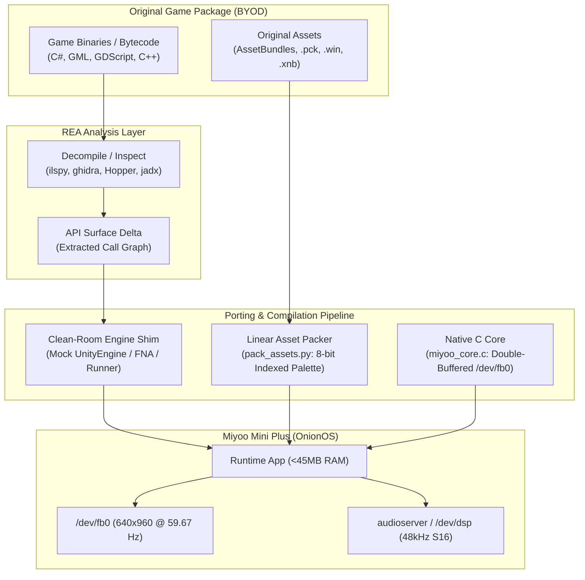

# Miyoo Mini Game Port Architect

A specialized skill for porting commercial and indie games to the **Miyoo Mini** and **Miyoo Mini Plus** running OnionOS.

Designed to operate in tandem with **REA (Reverse Engineer Anything)** for binary extraction, decompilation, and call-graph analysis.

---

## 1. Device Constraints & Hardware Profile (Field Verified)

Every architectural decision on the Miyoo Mini / Plus is dictated by the **SigmaStar SSD202D** SoC and OnionOS:

| Subsystem | Hardware Reality | Porting Implication |
| :--- | :--- | :--- |
| **CPU** | Dual-core ARM Cortex-A7 @ 1.2 GHz | 32-bit `armhf` (`armv7-a`, VFPv4-d16, NEON). Single-core IPC is low. Second core provides ~1.45× scaling (ideal for splitting screen rendering or background physics). |
| **RAM** | **128 MB DDR3 Total** (~103 MB user-space) | Kernel + MMA buffers carve out ~25 MB (`MemTotal` ~103 MB). Under Onion's MainUI, **only ~5–15 MB is free**. **Target process memory budget is <= 40–50 MB RSS**. Exceeding ~75 MB triggers Linux OOM killer. |
| **GPU** | **NONE** (No 3D GPU, No OpenGL ES, No Vulkan) | All rendering must be done via CPU software rasterization into `/dev/fb0`, or hardware accelerated via the SigmaStar 2D engine (`MI_GFX` / `libssgfx.so`). |
| **Display** | 640×480 IPS LCD (Rotated 180° on hardware) | **True refresh is 59.67 Hz** (16.76 ms). The kernel claims 75 Hz in `fb_var_screeninfo`—that value is wrong. Virtual FB is $640 \times 960$ (2 pages) flipped via `FBIOPAN_DISPLAY`. Memory is **uncached**; never read from `/dev/fb0`. |
| **Audio** | OnionOS `audioserver` / `/dev/dsp` | `/dev/mi_ao` is owned by `audioserver`. Write 16-bit stereo PCM (44.1/48 kHz) to `/dev/dsp` via `libpadsp.so` or via audioserver's FIFO pipes (`/tmp/audio_fifo_server`). **Never kill audioserver**. Retry write loops on `EINTR`. |
| **Input** | Linux `evdev` (`/dev/input/event0`) | Menu is `KEY_ESC` (1). X is `KEY_LEFTSHIFT` (42). Y is `KEY_LEFTALT` (56). L2 is `KEY_TAB` (15). R2 is `KEY_BACKSPACE` (14). Input thread must use non-blocking `poll()` to prevent shutdown hangs. |
| **Storage** | MicroSD formatted as FAT32 | Mounted with `dirsync`; each file creation costs ~15 ms. Always pack game assets into single linear files (`game.pack` or `.tar`). |

---

## 2. The Clean-Room Recompilation Pattern (CRRHB)

Because desktop engines require hundreds of megabytes of RAM and desktop/GLES graphics APIs, porting to the Miyoo Mini **does not port the original engine**.

Instead, this skill implements the **Clean-Room Recompilation & Hardware Blit (CRRHB)** pattern:



---

## 3. Engine Compatibility & 3D Feasibility

| Engine / Genre | Bytecode / Source Form | Porting Strategy | Transferability | Memory Risk |
| :--- | :--- | :--- | :--- | :--- |
| **Unity (Old 2D / 4.x - 2017)** | C# ECMA-335 IL (`Assembly-CSharp.dll`) | Hand-written `UnityEngine` shim + `gen_shim.py` stub layer + `miyoo_core.c` blitter. Run under ARM `mono-sgen`. | **95%** | Medium (GC allocation churn). |
| **MonoGame / XNA / FNA** | C# ECMA-335 IL | Provide clean-room `Microsoft.Xna.Framework.dll` shim. Route `SpriteBatch.Draw()` directly to `miyoo_core.c`. | **95%** | Low (XNA API is lightweight). |
| **GameMaker Studio (1.4 / 2.x)** | Bytecode (`data.win` / `game.unx`) | Decompile GML via REA to C++/C# or run via lightweight runner targeting `miyoo_core.c`. | **85%** | Low (Sprites fit in 8-bit palette). |
| **Custom C / C++ 2D Engines** | Native x86/ARM ELF or C/C++ source | Recompile with `arm-linux-gnueabihf-gcc`, replace OpenGL/SDL blit with `miyoo_core.c` double-buffered pan. | **90%** | Very Low (Native memory control). |
| **Retro Software 3D (Quake, PS1-era)** | C/C++ software rasterizer | Multi-core horizontal split (Core 0 top, Core 1 bottom). *TyrQuake* runs natively at 640×480 @ 60 FPS. | **85%** | Low to Moderate. |
| **Godot Engine 2D (3.x / 4.x)** | GDScript / C# / GDExtension | Compile custom minimal Godot ARMHF binary with 3D/physics disabled and `/dev/fb0` software rasterizer. | **75%** | High (Engine baseline memory). |
| **Modern 3D (Unreal, Unity 2021+ 3D)** | Native C++ / IL2CPP with shaders | **INCOMPATIBLE**. Hardware lacks 3D GPU. Software programmable shaders drop below 5 FPS. | **0%** | Extreme (>200MB baseline). |

---

## 4. OnionOS File & Directory Layout

To appear correctly in Onion's menu and pass the `import.log` validation, ports must strictly follow this structure:

```
/mnt/SDCARD/Roms/PORTS/
├── Shortcuts/
│   └── <Category>/
│       └── <GameName>.port       # Shortcut script invoking launch_standalone.sh
├── Games/
│   └── <GameDir>/
│       ├── launch.sh             # Main game entry script
│       ├── game_executable       # ARMHF binary
│       ├── libmiyoo_core.so      # Blitter core
│       └── game.pack             # Indexed asset package
└── Imgs/
    └── <GameName>.png            # 250x360 or 640x480 menu thumbnail
```

---

## 5. Phase-by-Phase Workflow

### Phase 1: REA Triage & Static Feasibility Assessment
1. **Detect Engine**: Use REA or `scripts/triage_game.py` to identify whether the target uses portable IL (Mono C#), GML bytecode, or native C++.
2. **Execute Feasibility Check**:
   ```bash
   python3 scripts/triage_game.py /path/to/game_directory
   ```
   If textures exceed 35 MB uncompressed, 8-bit palette indexing is mandatory.

### Phase 2: Asset Decoupling & Linear Packing
1. Extract raw PNG textures, OGG/WAV sound clips, and level JSONs using REA.
2. Run `scripts/pack_assets.py` to build a single linear binary package (`game.pack`):
   - **Sprites**: Convert to 8-bit indexed palette (RGBA palette + indexed pixel buffer).
   - **Audio**: Format as S16 stereo 44.1 kHz or 48 kHz.
   - **Seek Table**: Flat offset/length seek table for $O(1)$ zero-alloc reads.

### Phase 3: Clean-Room Engine Shim Generation
1. Use `scripts/gen_shim.py` alongside REA call-graph dumps to generate missing API declarations:
   ```bash
   python3 scripts/gen_shim.py <GameDir>/Managed generated_stubs.cs --hand ./engine/HandWritten
   ```
2. Compile dynamic `.so` libraries targeting **glibc <= 2.28** and using `-fsigned-char`.

### Phase 4: Native ARM Cortex-A7 Core (`miyoo_core.c`)
Integrate the high-performance C rendering core:
1. Memory-map `/dev/fb0` across all virtual pages ($640 \times 960$).
2. Double-buffering via `ioctl(fbfd, FBIOPAN_DISPLAY, &vinfo)`.
3. Inverted row-traversal to handle the 180° physically mounted LCD.
4. Non-blocking `poll()` input thread handling all 14 physical buttons.

### Phase 5: Headless SSH Verification & QA
1. **Prevent SSH Disconnect**:
   Starting a port normally kills background network daemons. Before running headless QA, touch the keep-alive flag:
   ```bash
   ssh root@<miyoo_ip> "touch /mnt/SDCARD/.tmp_update/config/.keepServicesAlive"
   ```
2. **Execute via Onion's Command Queue**:
   ```bash
   ssh root@<miyoo_ip> "echo 'cd /mnt/SDCARD/Roms/PORTS/Games/<GameDir> && ./launch.sh' > /tmp/cmd_to_run.sh && killall MainUI"
   ```
3. **Capture Accurate Screenshot**:
   ```bash
   ssh root@<miyoo_ip> "PAN=\$(cat /sys/class/graphics/fb0/pan | cut -d',' -f2); cat /dev/fb0 > /tmp/fb.raw; echo \$PAN"
   scp root@<miyoo_ip>:/tmp/fb.raw ./fb.raw
   python3 scripts/raw_to_png.py fb.raw screenshot.png --yoffset <PAN_OFFSET>
   ```

---

## 6. Golden Rules for Miyoo Mini Porting

1. **Memory Budget is <= 45 MB RSS**: Kernel and MMA carveouts reduce usable RAM from 128 MB down to ~103 MB, with MainUI leaving only ~5–15 MB free before swap.
2. **Never Read from `/dev/fb0`**: The framebuffer mapping is uncached. Reads incur heavy bus penalties.
3. **Always Double-Buffer with `FBIOPAN_DISPLAY`**: Writing to a single page causes severe tearing or writes to an inactive background page.
4. **Never Kill `audioserver`**: Output audio through `/dev/dsp` via `libpadsp.so` or write to audioserver's FIFO pipes.
5. **Panel Refresh is 59.67 Hz**: Disregard the 75 Hz kernel mode string.
6. **Input Keycodes**: Menu is `KEY_ESC` (1), X is `KEY_LEFTSHIFT` (42), Y is `KEY_LEFTALT` (56).
7. **BYOD Compliance**: Distribute only the clean-room engine shim, launcher scripts, and converters. Never bundle proprietary game assets.
