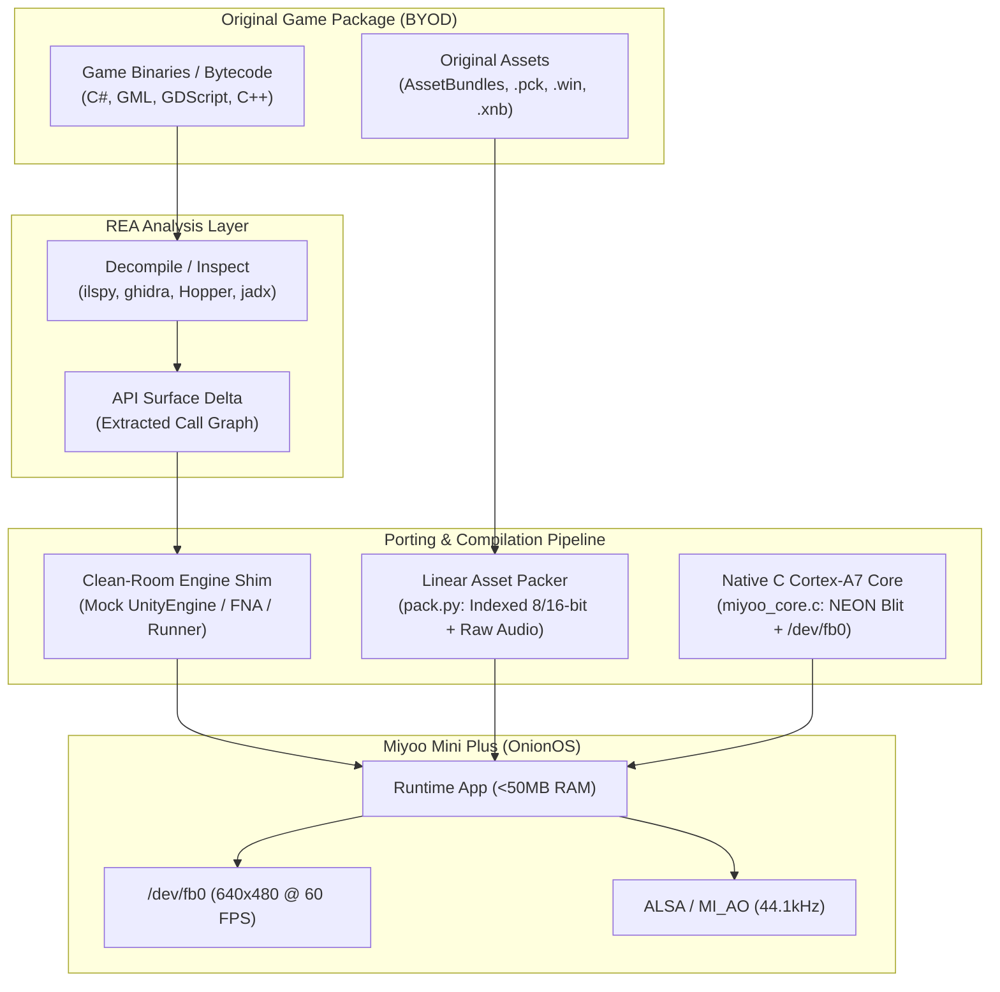

# Miyoo Mini Game Port Architect

A specialized skill for porting commercial and indie 2D games to the **Miyoo Mini** and **Miyoo Mini Plus** running OnionOS.

Designed to operate in tandem with **REA (Reverse Engineer Anything)** for binary extraction, decompilation, and call-graph analysis.

---

## 1. Device Constraints & Hardware Profile

Every architectural decision on the Miyoo Mini / Plus is dictated by the **SigmaStar SSD202D** SoC:

| Subsystem | Specification | Porting Implication |
| :--- | :--- | :--- |
| **CPU** | Dual-core ARM Cortex-A7 @ 1.2 GHz | 32-bit `armhf` (`armv7-a`, VFPv4-d16, NEON). Single-core IPC is low; thread dispatch overhead must be minimized. |
| **RAM** | **128 MB DDR3 Total** | OS & kernel claim ~35-45 MB. **Target process memory budget is 45-65 MB**. Exceeding ~85 MB triggers Linux OOM killer. |
| **GPU** | **NONE** (No 3D GPU, No OpenGL ES, No Vulkan) | All rendering must be done via CPU software rasterization straight into `/dev/fb0` (or 2D hardware blitter when available). |
| **Display** | 640×480 IPS LCD (Rotated 180° on hardware) | Framebuffer writes must handle physical 180° orientation. Native 320×240 internally scaled 2× with NEON scanline pairing is recommended. |
| **Audio** | SigmaStar MI AO / ALSA (`mi_ao`) | 44.1 kHz / 48 kHz 16-bit stereo PCM. Prefer ring-buffer streaming; avoid allocating large uncompressed audio buffers in RAM. |
| **Input** | Linux `evdev` (`/dev/input/event0`) | GPIO buttons map to standard Linux `KEY_*` event codes. |

---

## 2. The Clean-Room Recompilation Pattern (CRRHB)

Because original desktop engines (Unity, Godot, Unreal, Heavy MonoGame) require hundreds of megabytes of RAM and desktop/GLES graphics APIs, porting to the Miyoo Mini **does not port the original engine**.

Instead, this skill implements the **Clean-Room Recompilation & Hardware Blit (CRRHB)** pattern:



---

## 3. Engine Transferability Matrix

| Engine | Bytecode / Source Form | Porting Strategy | Transferability | Memory Risk |
| :--- | :--- | :--- | :--- | :--- |
| **Unity (Old / 4.x / 5.x / 2017 2D)** | C# ECMA-335 IL (`Assembly-CSharp.dll`) | Hand-written `UnityEngine` shim + `gen_shim.py` stub layer + `miyoo_core.c` blitter. Run under ARM `mono-sgen`. | **95%** | Medium (GC allocation churn). |
| **MonoGame / XNA / FNA** | C# ECMA-335 IL | Provide clean-room `Microsoft.Xna.Framework.dll` shim. Route `SpriteBatch.Draw()` directly to `miyoo_core.c`. | **95%** | Low (XNA API is lightweight). |
| **GameMaker Studio (1.4 / 2.x)** | Bytecode (`data.win` / `game.unx`) | **Option A**: Decompile GML via REA to C++/C# logic.<br>**Option B**: Compile lightweight open-source runner targeting `miyoo_core.c`. | **85%** | Low (2D sprites fit well in 8-bit palette). |
| **Godot Engine 2D (3.x / 4.x)** | GDScript / C# / GDExtension | Compile custom minimal Godot ARMHF binary with 3D/physics disabled and a custom software `/dev/fb0` rasterizer. | **75%** | High (Engine baseline memory is ~30-40MB). |
| **Custom C / C++ 2D Engines** | Native x86/ARM ELF or C/C++ source | Recompile with `arm-linux-gnueabihf-gcc`, replace OpenGL/SDL blit with `miyoo_core.c` direct framebuffer write. | **90%** | Very Low (Native control of all allocations). |
| **Modern 3D Engines (Unreal, Unity 2021+ 3D)** | Native C++ / IL2CPP | **INCOMPATIBLE**. Hardware lacks 3D GPU. Software 3D on Cortex-A7 drops below 5 FPS. | **0%** | Extreme (>200MB baseline). |

---

## 4. Phase-by-Phase Workflow

### Phase 1: REA Triage & Static Feasibility Assessment
Before writing code, run static analysis using REA:
1. **Detect Engine**:
   - Unity: Look for `Managed/`, `UnityEngine.dll`, `resources.assets`.
   - MonoGame: Look for `Content/*.xnb`, `Microsoft.Xna.Framework.dll`.
   - GameMaker: Look for `data.win`, `audiogroup*.dat`.
   - Godot: Look for `*.pck`, `project.godot`.
2. **Execute Feasibility Check**:
   ```bash
   python3 scripts/triage_game.py /path/to/game_directory
   ```
   - Checks total texture footprint uncompressed vs 128 MB RAM limit.
   - Flags unsupported shaders, heavy 3D mesh dependencies, or native plugin blobs (`.so`/`.dll`).
   - If textures exceed 40 MB uncompressed, 8-bit palette indexing or downsampling is required.

### Phase 2: Asset Decoupling & Linear Packing
Original container files (AssetBundles, `.pck`, `.win`, `.xnb`) must never be loaded dynamically at runtime by heavy asset engines.
1. Extract raw PNG textures, OGG/WAV sound clips, and level JSONs using REA or asset dumpers.
2. Run `scripts/pack_assets.py` to build a single linear binary package (`game.pack`):
   - **Sprites**: Convert to 8-bit indexed palette (RGBA palette + indexed pixel buffer) or RGB565 / RGBA4444.
   - **Audio**: Downsample to 22.05 kHz or 44.1 kHz 16-bit mono/stereo PCM or lightweight ADPCM/OGG.
   - **Header Table**: Flat offset/length seek table for $O(1)$ zero-alloc reads.

### Phase 3: Clean-Room Engine Shim Generation
1. Use REA or `api_surface.py` to inspect the game assemblies:
   - Identify which engine classes, methods, and properties are referenced.
   - Determine which members govern active gameplay vs engine boilerplate (analytics, telemetry, achievements, cloud saves).
2. Generate the stub boundary:
   ```bash
   python3 scripts/gen_shim.py <GameDir>/Managed generated_stubs.cs --hand ./engine/HandWritten
   ```
   - Hand-write the core loop: `GameObject`, `Transform`, `Component`, `Update()`, `Coroutine`, `Renderer`.
   - Generate stub fallbacks for benign services (`Steamworks`, `Analytics`, `VR`, `PostProcessing`).

### Phase 4: Native ARM Cortex-A7 Core (`miyoo_core.c`)
Integrate the high-performance C rendering core:
1. Direct memory-mapped access to `/dev/fb0`.
2. $2\times$ Integer Upscale via ARM NEON SIMD:
   - Takes 320×240 (or 320×180 letterboxed) internal surface and doubles pixels to fill 640×480 screen.
   - Line-pair copy using 64-bit/128-bit NEON load/store.
3. Physical 180° Rotation:
   - The Miyoo Mini LCD panel is mounted upside down; the blitter handles the inverse row traversal with zero additional latency.
4. Input Polling via `pthread` reading `/dev/input/event0` (non-blocking).

### Phase 5: Build Automation & BYOD Packaging
1. Keep the port repository **100% clean-room** (zero copyrighted game assets or proprietary code).
2. Create `./compile.sh` and `./setup.sh`:
   - Validates user-provided game files from Steam, GOG, or Epic Games.
   - Automatically invokes asset extraction and binary packing.
   - Compiles native C core and managed C# shims.
   - Emits an OnionOS-compliant release folder:
     ```
     App/
     ├── launch.sh
     ├── game_armhf
     ├── miyoo_core.so
     └── game.pack
     ```

### Phase 6: Headless SSH Verification & QA
Always verify port stability on a real device or headless ARM container:
1. Transfer files via SSH/SCP:
   ```bash
   scp -r App/* root@<miyoo_ip>:/mnt/SDCARD/Roms/PORTS/Game/
   ```
2. Launch headlessly and inspect logs:
   ```bash
   ssh root@<miyoo_ip> "cd /mnt/SDCARD/Roms/PORTS/Game && ./launch.sh > log.txt 2>&1 &"
   ```
3. Take framebuffer dump to verify visual output:
   ```bash
   ssh root@<miyoo_ip> "cat /dev/fb0 > /tmp/fb.raw"
   python3 scripts/raw_to_png.py /tmp/fb.raw screenshot.png 640 480
   ```
4. Verify memory ceiling via `top` / `free -m`:
   - Resident Set Size (RSS) must stay below 60 MB.

---

## 5. Golden Rules for Miyoo Mini Porting

1. **Never Trust Desktop Dynamic Memory**: If a game allocates 10,000 temporary objects per frame on desktop, Mono's garbage collector on Cortex-A7 will stall the CPU every 3 seconds. Pre-allocate object pools.
2. **Never Render at Native 640×480 Directly**: Software rasterizing 307,200 pixels with alpha blending and depth sorting at 60 FPS exceeds Cortex-A7 memory bandwidth. Always render to 320×240 or 320×180 and upscale with NEON scanline duplication.
3. **Use 8-Bit Palettes for Sprites**: RGBA32 textures consume 4 bytes per pixel. 8-bit indexed textures consume 1 byte per pixel + 1024 bytes per palette. This single technique reduces asset memory from 80 MB down to 20 MB.
4. **Isolate Material / State Blocks**: When shimming sprite tinting or flashing effects, deep-copy property blocks to prevent visual bleeding across distinct renderers.
5. **BYOD Compliance**: Never distribute original assets or proprietary decompiled binaries. Distribute the clean-room shim, the build scripts, and the asset converter.
