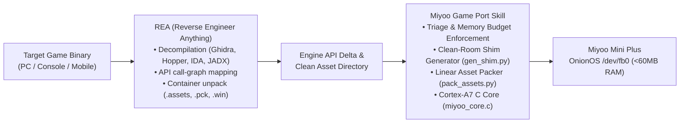

# Pairing REA with Miyoo Mini Game Port

The **Reverse Engineer Anything (REA)** MCP server and skill provide the upstream reverse-engineering and binary analysis capabilities. **Miyoo Game Port** provides the downstream embedded recompilation and hardware targeting pipeline.



---

## The Co-Pilot Workflow

### Step 1: Upstream REA Discovery
Ask REA:
> *"Inspect the target game directory. What engine was used? Extract the main executable or managed assemblies, and report which engine functions and libraries are imported."*

REA will:
1. Identify the binary format (PE32, ELF, Mach-O, APK, Unity, MonoGame).
2. Decompile assemblies to generate IL or C++ pseudo-code.
3. List external library dependencies (e.g., `UnityEngine.dll`, `FNA.dll`, `SDL2.dll`, `Steamworks.dll`).

### Step 2: Feasibility Triage
Run `triage_game.py` from `miyoo-game-port`:
```bash
python3 scripts/triage_game.py /path/to/game
```
- Compare total asset volume against the 128 MB RAM ceiling.
- Detect whether shaders or 3D meshes are required.

### Step 3: Clean-Room Interface Generation
Use `gen_shim.py` alongside REA call-graph dumps:
- Identify missing classes or methods called by the game.
- Automatically emit stub declarations and empty implementations with logging:
```bash
python3 scripts/gen_shim.py <GameDir>/Managed generated_stubs.cs --hand ./engine/HandWritten
```

### Step 4: Asset Decoupling & Quantization
Use REA to dump raw sprite textures, then run:
```bash
python3 scripts/pack_assets.py --input ./raw_assets --output ./dist/game.pack --format indexed8
```
This reduces RGBA32 texture overhead by ~75%, fitting large game worlds into 128 MB RAM.

### Step 5: Native Cortex-A7 Blitter Integration
Link the game logic to `templates/native_core/miyoo_core.c` and verify in OnionOS via headless SSH.
